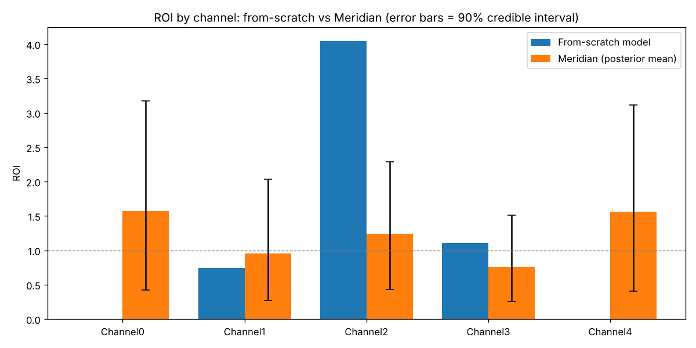
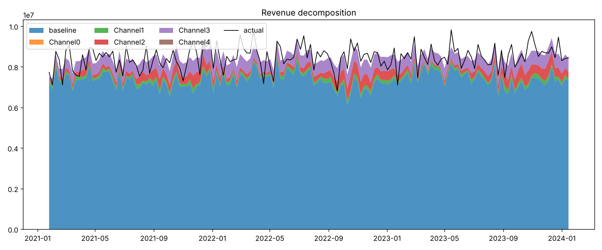
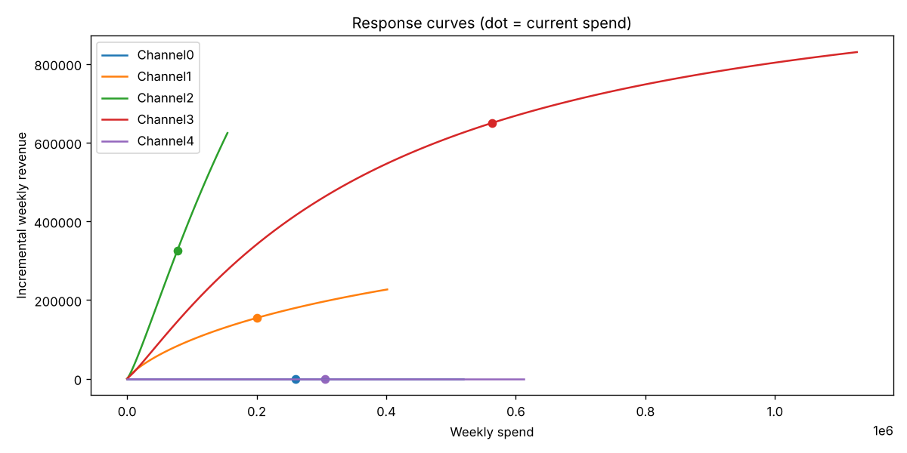

# Marketing Mix Modeling & Budget Optimizer

[](https://colab.research.google.com/github/hamzacharrad29-png/mmm-budget-optimizer/blob/main/mmm_colab.ipynb)


**Business question:** which marketing channels actually drive revenue, and how should the budget be reallocated?

This project answers it twice: with a Marketing Mix Model written from scratch (NumPy / SciPy) and with
Google's Bayesian MMM library [Meridian](https://github.com/google/meridian), then compares the two.
A Streamlit app lets you simulate budget scenarios with the from-scratch model.

## Data
Google Meridian's public **simulated** dataset ([`data/geo_all_channels.csv`](data/)): weekly data for 40 regions,
5 paid media channels (impressions + spend), 1 organic channel, a promotion variable and 2 control variables
(156 weeks, January 2021 to January 2024). Revenue = conversions x revenue per conversion.

## Method
1. **From-scratch MMM** ([`mmm_core.py`](mmm_core.py), [`train.py`](train.py)): geometric adstock + Hill saturation +
   bounded least squares (media effects >= 0); adstock and saturation parameters tuned with differential evolution
   on a validation window; time-based 70 / 15 / 15 train / validation / test split; national weekly data.
2. **Bayesian MMM with Google Meridian** ([`run_meridian.py`](run_meridian.py)): regional data with impressions,
   LogNormal ROI prior, automatic knot selection for the baseline, MCMC (4 chains x 500 kept draws),
   ROI with 90% credible intervals and budget optimization.
3. **Comparison** ([`compare.py`](compare.py)): ROI, channel ranking, share of effect and budget recommendation.
4. **Streamlit simulator** ([`app.py`](app.py)): optimal budget allocation under a total budget and per-channel limits.

## Results

| | From-scratch (national) | Meridian (40 regions) |
|---|---|---|
| Fit | Test R² = 0.42, MAPE = 3.5% | R² = 0.77, MAPE = 2.7%; health score 99.8/100, R-hat < 1.2 |
| Best channel by ROI | Channel2 (ROI = 4.04) | Channel0 (1.57) and Channel4 (1.57) |
| Same budget, re-allocated (+/-50% per channel) | +23.4% media-driven revenue | see `reports/optimization_output.html` |

**ROI by channel**

| Channel | Share of spend | From-scratch ROI | Meridian ROI (90% interval) |
|---|---|---|---|
| Channel0 | 18.5% | 0.00 | 1.57 (0.42 to 3.18) |
| Channel1 | 14.3% | 0.74 | 0.95 (0.27 to 2.04) |
| Channel2 | 5.5% | 4.04 | 1.24 (0.43 to 2.29) |
| Channel3 | 40.0% | 1.11 | 0.76 (0.25 to 1.51) |
| Channel4 | 21.7% | 0.00 | 1.57 (0.41 to 3.12) |



**Model comparison.** The two models disagree: rank correlation = -0.70, only 2/5 from-scratch ROI estimates
(Channel1 and Channel3) fall inside Meridian's 90% credible interval, and the budget recommendations point in the
same direction on 1/5 channels (both increase Channel2). The main gap is on Channel0 and Channel4: the national
model gives them zero effect, while Meridian estimates them as the two best channels. Aggregating 40 regions into a
single national series removes most of the variation that separates the channels' effects, and the from-scratch
ROI estimates change noticeably with the optimizer's random seed (Channel2 stays first and Channel4 stays at zero). Meridian uses the regional variation and
impressions, passes all its health checks, and its credible intervals all overlap, so the ranking itself is
uncertain. The next step would be to calibrate the ROI of Channel0, Channel3 and Channel4 (the largest budgets)
with geo experiments.




All numbers come from the files in [`outputs/`](outputs/) (`fit_quality.json`, `roi_scratch.csv`, `roi_meridian.csv`,
`budget_uplift.json`, `model_comparison.csv`, `budget_comparison.csv`). The full Meridian reports are in
[`reports/`](reports/): download an HTML file and open it in a browser.

## Project structure
```
mmm-budget-optimizer/
├── data/
│   └── geo_all_channels.csv     Meridian's simulated dataset
├── outputs/                     charts, CSVs, model_params.json (used by the app)
├── reports/                     Meridian HTML reports (summary, optimization, health card)
├── mmm_core.py                  model: adstock, saturation, fitting, ROI, budget optimizer
├── train.py                     from-scratch analysis -> outputs/
├── run_meridian.py              Google Meridian (GPU recommended) -> outputs/ + reports/
├── compare.py                   from-scratch vs Meridian -> outputs/model_comparison.csv + chart
├── app.py                       Streamlit budget simulator
├── mmm_colab.ipynb              runs everything in Google Colab
├── requirements.txt             dependencies for the from-scratch model and the app
└── requirements-meridian.txt    adds Google Meridian
```

## How to run

### 1. Run the Streamlit app (on your computer)
The app only needs `outputs/model_params.json`, which is already in the repository, so no GPU and no Meridian are needed.

```bash
git clone https://github.com/hamzacharrad29-png/mmm-budget-optimizer.git
cd mmm-budget-optimizer

python -m venv .venv
source .venv/bin/activate          # Windows: .venv\Scripts\activate
pip install -r requirements.txt

streamlit run app.py
```
Your browser opens at http://localhost:8501 (stop the app with `Ctrl+C`).


In the app:
- **Total weekly budget (% of current)**: scale the total budget between 60% and 140% of current spend.
- **Max change per channel (+/- %)**: how far each channel may move away from its current spend.
- The metrics compare weekly media-driven revenue with the current mix and with the optimized mix for the same budget.
- The table shows current and optimized spend, ROI and marginal ROI per channel; the response-curve chart shows where
  each channel sits on its saturation curve.

### 2. Re-train the from-scratch model (about 1 minute, CPU)
```bash
python train.py
```
This rewrites the charts, CSVs and `outputs/model_params.json`; restart the app to use the new parameters.

### 3. Run Google Meridian and the comparison
**Recommended: Google Colab.** Click the *Open in Colab* badge above, choose **Runtime > Change runtime type > T4 GPU**,
then **Runtime > Run all** (about 20-30 minutes). The notebook clones this repository, runs `train.py`,
`run_meridian.py` and `compare.py`, and downloads a zip with `outputs/` and `reports/`. Copy those two folders into
your local repository to update the results.

**Locally** (a GPU is strongly recommended; on a 2-core CPU the run takes about 25 minutes):
```bash
pip install -r requirements-meridian.txt
python run_meridian.py             # quick smoke test: MERIDIAN_QUICK=1 python run_meridian.py
python compare.py
```

## Limitations
Simulated data; short history (156 weeks); correlated channels; national aggregation in the from-scratch model;
the budget optimizers of the two models use different response definitions (steady-state weekly response vs
Meridian's historical flighting); no calibration with experiments (geo tests).

## License
Code: [MIT](LICENSE). Dataset: Google Meridian, Apache License 2.0.
