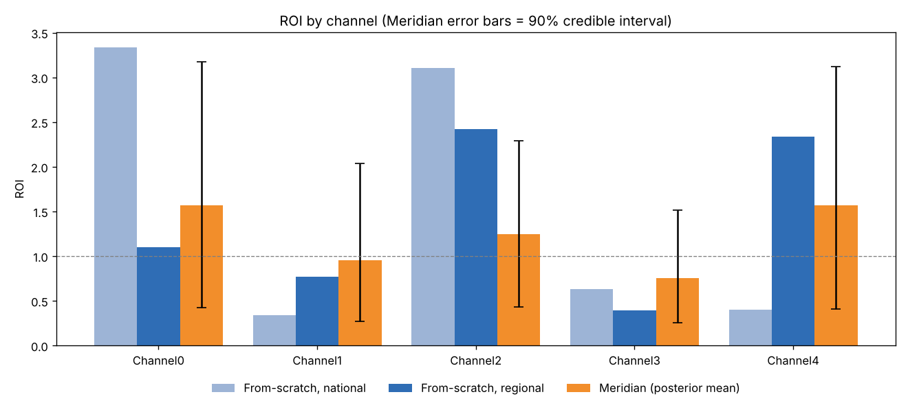
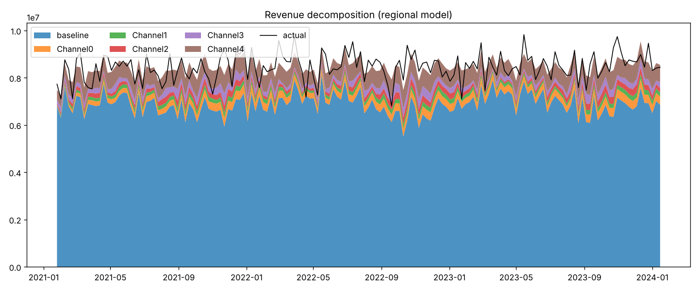
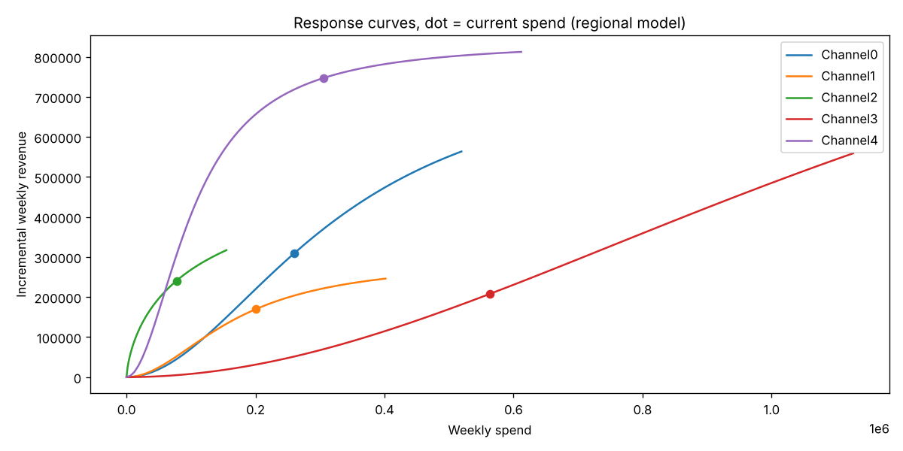
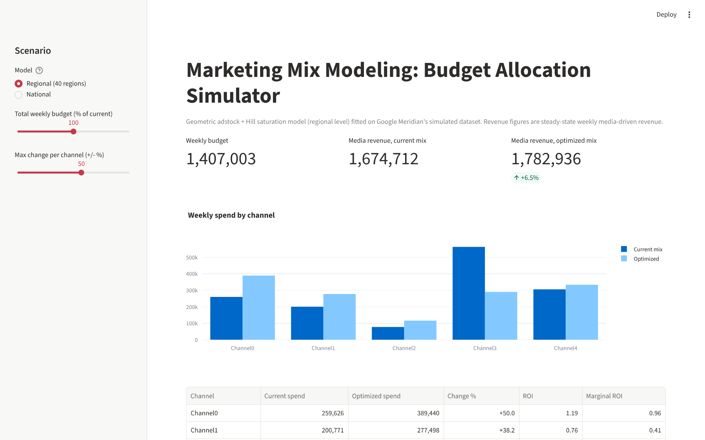

# Marketing Mix Modeling & Budget Optimizer

[](https://colab.research.google.com/github/hamzacharrad29-png/mmm-budget-optimizer/blob/main/mmm_colab.ipynb)


**Business question:** which marketing channels actually drive revenue, and how should the budget be reallocated?

This project builds a Marketing Mix Model from scratch (NumPy / SciPy), fits it on **national** totals and on
**regional** data (40 regions), and benchmarks both against Google's Bayesian MMM library
[Meridian](https://github.com/google/meridian). A Streamlit app turns the model into a budget simulator.

## Data
Google Meridian's public **simulated** dataset ([`data/geo_all_channels.csv`](data/)): weekly data for 40 regions,
5 paid media channels (impressions + spend), 1 organic channel, a promotion variable and 2 control variables
(156 weeks, January 2021 to January 2024). Revenue = conversions x revenue per conversion.

## Method
1. **From-scratch MMM** ([`mmm_core.py`](mmm_core.py), [`train.py`](train.py)), per region and week, per capita:
   - geometric adstock (carry-over) + Hill saturation (diminishing returns) for each channel;
   - one intercept per region (fixed effects), shared trend, yearly seasonality and control variables;
   - media effects >= 0, solved by population-weighted bounded least squares;
   - adstock and saturation parameters tuned with differential evolution;
   - time-based split: first 85% of weeks to fit, last 15% (24 weeks) as a hold-out test set.

   The **national** model is the same code with the 40 regions summed into one series (156 data points instead of
   6,240), so the only difference between the two is the level of detail of the data.
2. **Bayesian MMM with Google Meridian** ([`run_meridian.py`](run_meridian.py)): regional data with impressions,
   LogNormal ROI prior, automatic knot selection for the baseline, MCMC (4 chains x 500 kept draws),
   ROI with 90% credible intervals and budget optimization.
3. **Comparison** ([`compare.py`](compare.py)): ROI, channel ranking and budget recommendation of the three models.
4. **Streamlit simulator** ([`app.py`](app.py)): optimal budget allocation under a total budget and per-channel limits,
   with either the regional or the national model.

## Results

**Agreement with Meridian**

| | From-scratch, national | From-scratch, regional |
|---|---|---|
| ROI inside Meridian's 90% credible interval | 2 / 5 channels | **4 / 5 channels** |
| Same budget direction as Meridian (increase / decrease) | 3 / 5 channels | **4 / 5 channels** |
| Rank correlation of channel ROI with Meridian | 0.50 | **0.60** |
| Test R² on national weekly revenue (last 24 weeks) | 0.19 | **0.42** |
| Test MAPE on national weekly revenue | 4.3% | **3.4%** |

Meridian's own fit: R² = 0.77, MAPE = 2.7%, model health score 99.8/100, all R-hat < 1.2.

**ROI by channel** (incremental revenue / spend, full period)

| Channel | Share of spend | National | Regional | Meridian (90% interval) |
|---|---|---|---|---|
| Channel0 | 18.5% | 3.33 | 1.10 | 1.57 (0.42 to 3.17) |
| Channel1 | 14.3% | 0.34 | 0.77 | 0.95 (0.27 to 2.04) |
| Channel2 | 5.5% | 3.10 | 2.42 | 1.24 (0.43 to 2.29) |
| Channel3 | 40.0% | 0.63 | 0.39 | 0.76 (0.25 to 1.51) |
| Channel4 | 21.7% | 0.40 | 2.33 | 1.57 (0.41 to 3.12) |



**Budget recommendation** (same total budget, each channel within +/-50%)

| Channel | National | Regional | Meridian |
|---|---|---|---|
| Channel0 | +10% | +50% | +42% |
| Channel1 | -50% | +38% | -15% |
| Channel2 | +50% | +50% | +36% |
| Channel3 | +34% | -49% | -37% |
| Channel4 | -50% | +9% | +33% |

**What the comparison shows.** Fitting the same model on regional data instead of national totals brings it much
closer to Meridian: 4 of 5 ROI estimates fall inside Meridian's credible intervals (vs 2 of 5), the budget
recommendation points the same way on 4 of 5 channels, and the test error on national revenue drops. Summing 40
regions into one series leaves 156 data points for 5 correlated channels and removes the differences between regions
that help separate each channel's effect. The national model disagrees most on Channel4 (ROI 0.40 vs 2.33 regional and
1.57 in Meridian) and recommends growing Channel3, the largest budget, which both regional models say to cut.

Where the regional model still differs: it ranks Channel2 first (ROI 2.42, just above Meridian's interval) while
Meridian ranks Channel0 and Channel4 first, and it recommends increasing Channel1. Meridian's credible intervals overlap
for every channel, so the exact ranking is uncertain. The robust conclusions shared by both regional models are:
**Channel3 (40% of spend) has the lowest ROI and should be cut, Channel0 and Channel2 should grow.** Calibrating
Channel3 and Channel4 with geo experiments would be the next step.

Re-allocating the same budget gives **+6.5% media-driven revenue** with the regional model (+22.9% with the national
model, which is less reliable).




All numbers come from the files in [`outputs/`](outputs/). The full Meridian reports are in [`reports/`](reports/):
download an HTML file and open it in a browser.

## Project structure
```
mmm-budget-optimizer/
├── data/
│   └── geo_all_channels.csv     Meridian's simulated dataset
├── docs/
│   └── app_screenshot.png
├── outputs/
│   ├── 01_eda.png               revenue and spend over time
│   ├── national/                national model: fit, decomposition, ROI, response curves, budget, model_params.json
│   ├── regional/                regional model: same files
│   ├── meridian/                Meridian ROI (with 90% intervals) and budget recommendation
│   └── comparison/              three-model comparison: tables and chart
├── reports/                     Meridian HTML reports (summary, optimization, health card)
├── mmm_core.py                  model: data loading, adstock, saturation, fitting, ROI, budget optimizer
├── train.py                     fits the national and regional models -> outputs/national/, outputs/regional/
├── run_meridian.py              Google Meridian (GPU recommended) -> outputs/meridian/ + reports/
├── compare.py                   three-model comparison -> outputs/comparison/
├── app.py                       Streamlit budget simulator
├── mmm_colab.ipynb              runs everything in Google Colab
├── requirements.txt             dependencies for the from-scratch model and the app
└── requirements-meridian.txt    adds Google Meridian
```

## How to run

### 1. Run the Streamlit app (on your computer)
The app reads `outputs/regional/model_params.json` and `outputs/national/model_params.json`, which are already in the
repository, so no GPU and no Meridian are needed.

```bash
git clone https://github.com/hamzacharrad29-png/mmm-budget-optimizer.git
cd mmm-budget-optimizer

python -m venv .venv
source .venv/bin/activate          # Windows: .venv\Scripts\activate
pip install -r requirements.txt

streamlit run app.py
```
Your browser opens at http://localhost:8501 (stop the app with `Ctrl+C`).



In the app:
- **Model**: the regional model (default) or the national model.
- **Total weekly budget (% of current)**: scale the total budget between 60% and 140% of current spend.
- **Max change per channel (+/- %)**: how far each channel may move away from its current spend.
- The metrics compare weekly media-driven revenue with the current mix and with the optimized mix for the same budget.
- The table shows current and optimized spend, ROI and marginal ROI per channel; the response-curve chart shows where
  each channel sits on its saturation curve.

### 2. Re-train the from-scratch models (about 2 minutes, CPU)
```bash
python train.py                    # both levels
python train.py --level regional   # one level only
```
This rewrites `outputs/national/` and `outputs/regional/`; restart the app to use the new parameters.

### 3. Run Google Meridian and the comparison
**Recommended: Google Colab.** Click the *Open in Colab* badge above, choose **Runtime > Change runtime type > T4 GPU**,
then **Runtime > Run all** (about 20-30 minutes). The notebook clones this repository, runs `train.py`,
`run_meridian.py` and `compare.py`, and downloads a zip with `outputs/` and `reports/`. Copy those two folders into
your local repository to update the results.

**Locally** (a GPU is strongly recommended; on a 2-core CPU the run takes about 25 minutes):
```bash
pip install -r requirements-meridian.txt
python run_meridian.py             # quick smoke test: MERIDIAN_QUICK=1 python run_meridian.py
python compare.py
```

## Limitations
Simulated data; short history (156 weeks); correlated channels; week-to-week revenue in a single region is very noisy
(per-region test R² = 0.71 comes mostly from differences between regions, per-region MAPE is about 33%); the from-scratch
model uses spend only while Meridian also uses impressions; the budget optimizers use different response definitions
(steady-state weekly response vs Meridian's historical flighting); no calibration with experiments (geo tests).

## License
Code: [MIT](LICENSE). Dataset: Google Meridian, Apache License 2.0.
